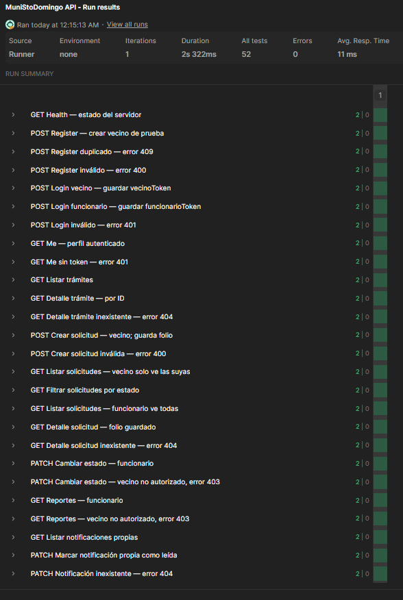
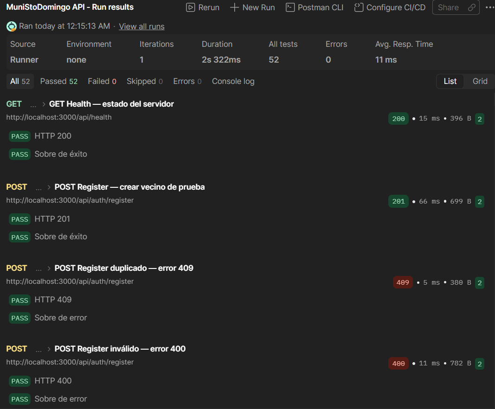
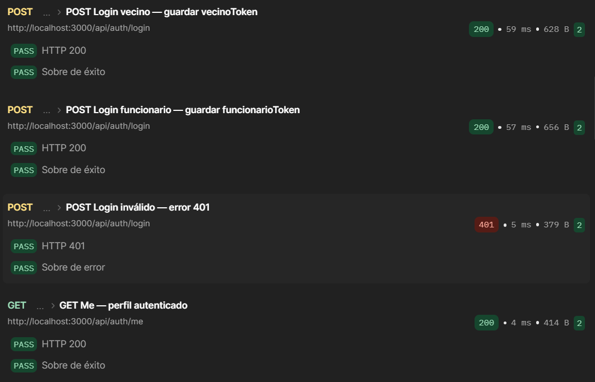
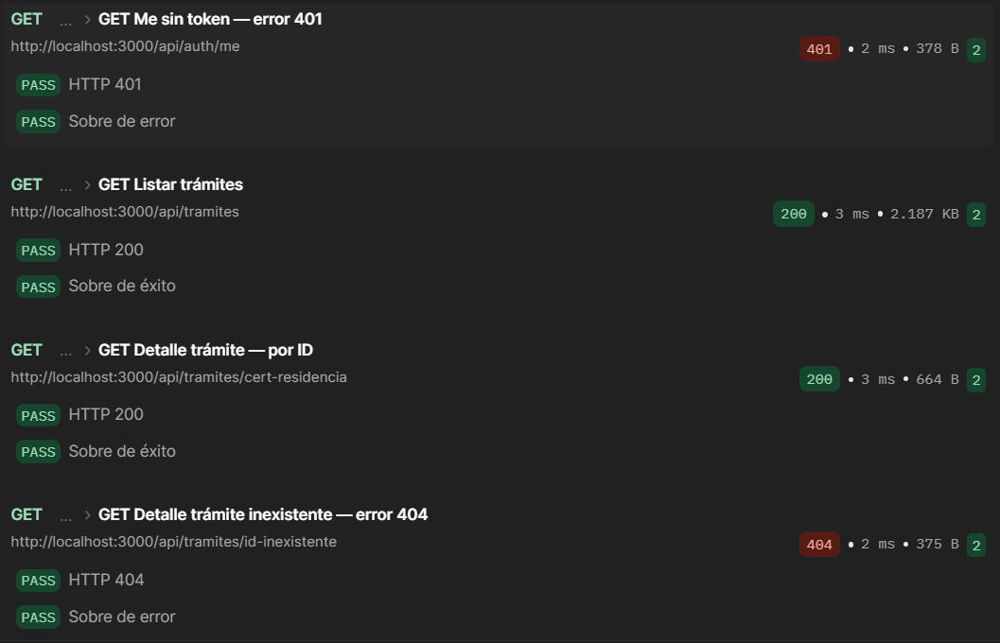
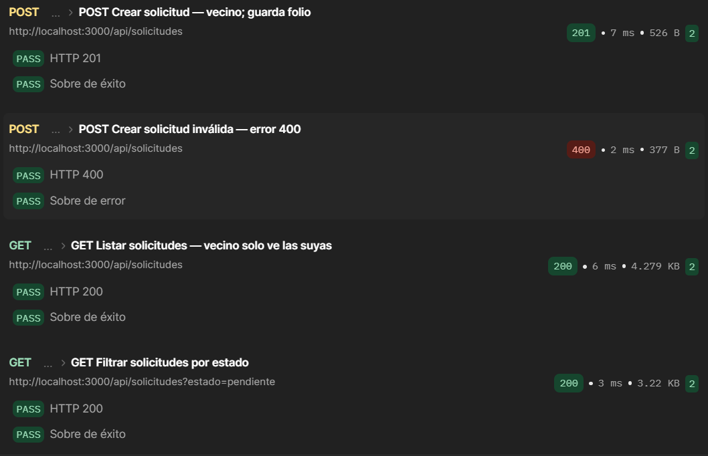
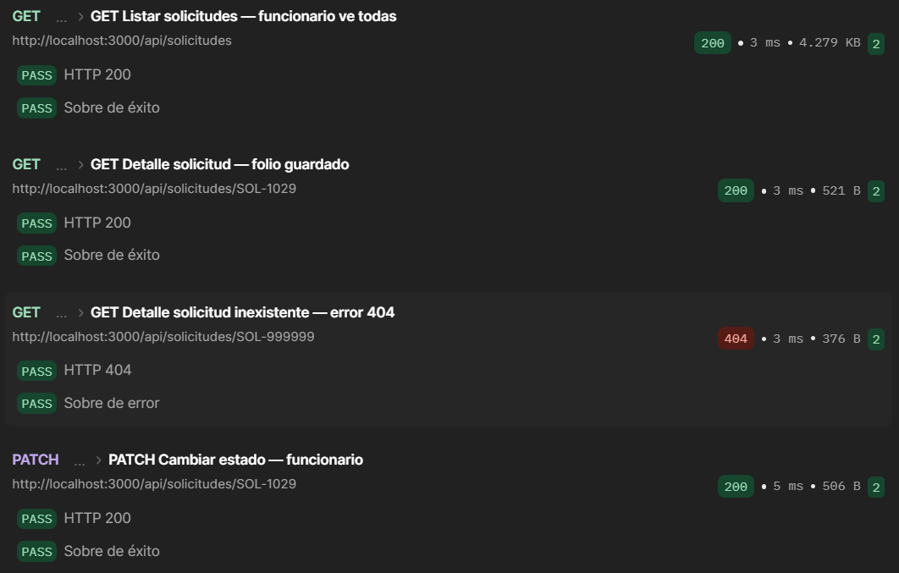
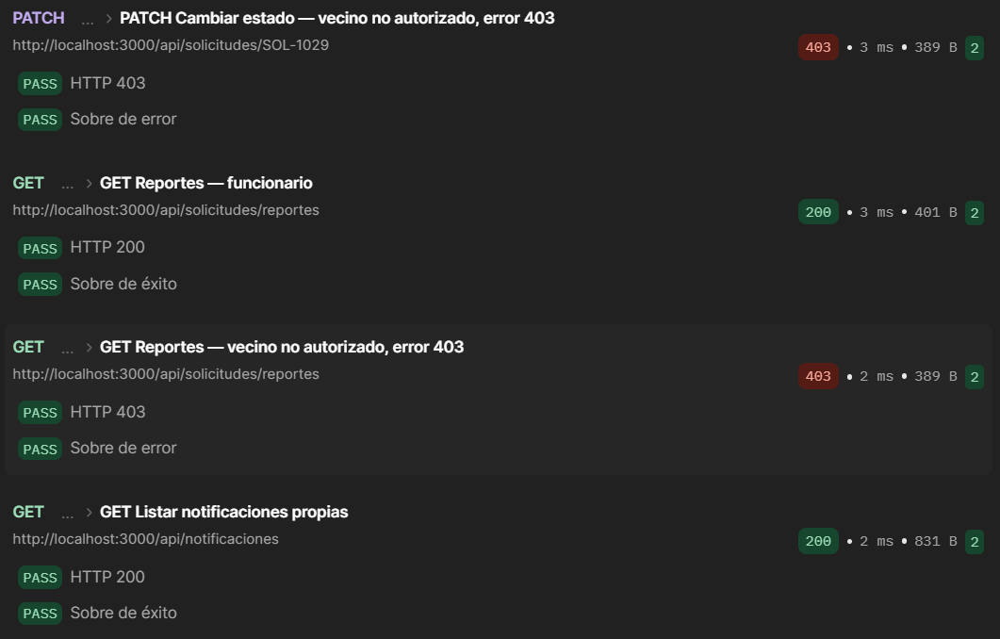
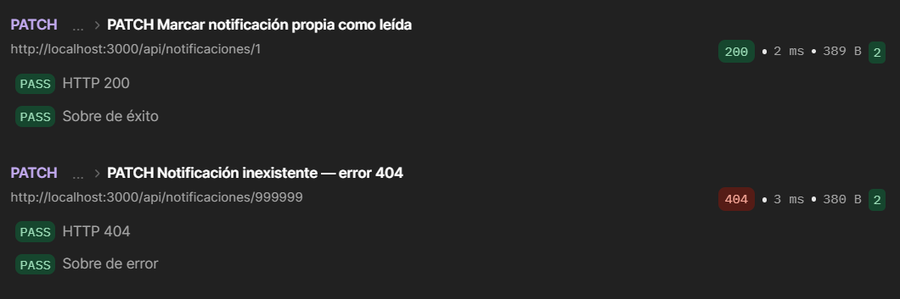

# MuniStoDomingo-Tramites - Backend

Rama con la lógica de servidor del proyecto: API REST, acceso a la base de datos y
procesamiento de la información.

La documentación general del proyecto está en la rama `main`. El código de la interfaz
está en la rama `frontend`.

| Documento | Para quién | Contenido |
| --- | --- | --- |
| Este README | Todos | Cómo levantar el backend, estructura y convenciones |
| [docs/API.md](docs/API.md) | Frontend, backend, evaluación | Referencia de cada endpoint con ejemplos de petición y respuesta |
| [docs/CHECKLIST_AVANCES.md](docs/CHECKLIST_AVANCES.md) | Cada integrante | Qué está listo, qué falta, qué le toca a cada rol y cómo integrarlo |

## Integrantes

- Simón Ledezma — Base de datos y servicios
- Tomás Monge — Servidor Express y endpoints REST
- Francisco Espinoza — Autenticación JWT y seguridad
- Melissa Rojas — Integración frontend y pruebas

## Stack tecnológico

- Node.js 18+ + Express.js 5 + TypeScript
- MySQL 8 / MariaDB 10+ (driver `mysql2`)
- JSON Web Tokens (jsonwebtoken)
- bcrypt para hash de contraseñas
- express-validator para validación de inputs
- cors para Cross-Origin Resource Sharing
- dotenv para variables de entorno

## Puesta en marcha

### 1. Base de datos

Se necesita un servidor MySQL o MariaDB corriendo en el puerto 3306. La forma más simple en
Windows es [XAMPP](https://www.apachefriends.org): instalarlo y presionar *Start* en
**MySQL** desde el panel de control. El usuario `root` de XAMPP viene sin contraseña.

Cargar el esquema con sus datos de prueba (crea la base `muni_stodomingo` por sí solo):

```bash
mysql -u root -p --default-character-set=utf8mb4 < schema.sql
```

Con XAMPP el cliente está en `C:\xampp\mysql\bin\mysql.exe` y se omite `-p` si `root` no
tiene contraseña. También se puede importar `schema.sql` desde phpMyAdmin
(http://localhost/phpmyadmin → *Importar*).

`schema.sql` crea las cinco tablas y carga datos semilla, de modo que el sistema queda
utilizable apenas se levanta. **No se puede ejecutar dos veces**: para volver a la semilla
primero hay que borrar la base.

```bash
mysql -u root -p -e "DROP DATABASE muni_stodomingo"
mysql -u root -p --default-character-set=utf8mb4 < schema.sql
```

### 2. Backend

```bash
npm install
cp .env.example .env     # completar DB_PASSWORD y JWT_SECRET
npm run dev
```

Si todo está bien la consola muestra `✅ Servidor corriendo en http://localhost:3000`, y
http://localhost:3000/api/health responde `{ "success": true, "data": { "status": "ok", ... } }`.

**El servidor no arranca si `JWT_SECRET` está vacío, tiene menos de 32 caracteres o
contiene el texto `cambiar`** (el placeholder de `.env.example`). Para generar uno:

```bash
node -e "console.log(require('node:crypto').randomBytes(48).toString('hex'))"
```

`JWT_EXPIRES_IN` acepta una duración como `24h` o segundos enteros, y debe ser positiva.

### Scripts

| Script | Qué hace |
| --- | --- |
| `npm run dev` | Levanta el servidor con `ts-node` y lo reinicia con `nodemon` al guardar cambios en `src/` |
| `npm run typecheck` | Revisa los tipos sin generar archivos. Debe pasar antes de abrir un PR |
| `npm test` | Compila y ejecuta las pruebas (`tests/`). **Necesitan MySQL/MariaDB en marcha**, ver [Pruebas](#pruebas) |
| `npm run build` | Compila TypeScript a `dist/` |
| `npm start` | Ejecuta la versión compilada (`dist/server.js`) |

### Pruebas

`tests/auth.test.cjs` prueba auth y roles con la persistencia simulada. `tests/api.test.cjs`
prueba **toda la API contra una base real** (registro, solicitudes, folios simultáneos,
permisos por dueño, notificaciones, reportes).

La base de pruebas se llama `muni_stodomingo_test`: se **borra y recrea desde `schema.sql`**
en cada ejecución, y nunca usa el `DB_NAME` del `.env`. Con XAMPP (MySQL encendido, `root` sin
contraseña) basta con `npm test`. Para otra conexión:

```bash
TEST_DB_HOST=localhost TEST_DB_PORT=3306 TEST_DB_USER=root TEST_DB_PASSWORD= npm test
# Sin XAMPP, con Docker:
docker run -d --name muni-test-db -e MARIADB_ALLOW_EMPTY_ROOT_PASSWORD=1 -p 127.0.0.1:3307:3306 mariadb:11.4
TEST_DB_PORT=3307 npm test
```

El usuario de la base necesita permiso para `CREATE`/`DROP DATABASE`. `TEST_DB_NAME` debe
terminar en `_test`.

#### Validación manual con Postman

1. Iniciar MySQL/MariaDB y el backend (`npm run dev`).
2. En Postman, importar `postman_collection.json`.
3. Ejecutar la colección **MuniStoDomingo API** con el Runner. La variable `baseUrl` debe apuntar a `http://localhost:3000`.
4. Confirmar que todas las pruebas pasen. La ejecución validada obtuvo **52 pruebas aprobadas, 0 fallidas y 0 errores**.

Las solicitudes de registro, creación o actualización modifican la base configurada en el backend. Para las pruebas, usar una instancia local.

Evidencia de ejecución:

















### Variables de entorno

| Variable | Para qué | Valor de desarrollo |
| --- | --- | --- |
| `DB_HOST`, `DB_PORT` | Servidor de base de datos | `localhost`, `3306` |
| `DB_USER`, `DB_PASSWORD` | Credenciales | `root` y vacío con XAMPP |
| `DB_NAME` | Base de datos | `muni_stodomingo` |
| `JWT_SECRET` | Firma de los tokens de sesión | String aleatorio de 32+ caracteres |
| `JWT_EXPIRES_IN` | Vigencia de los tokens | `24h` |
| `PORT` | Puerto del servidor | `3000` |
| `NODE_ENV` | En `development` los errores 500 muestran el detalle | `development` |
| `FRONTEND_URL` | Origen permitido por CORS | `http://localhost:5173` si el front corre con Vite (`npm run dev`), `http://localhost:8100` con `ionic serve` |

El archivo `.env` nunca se sube al repositorio; `.env.example` documenta las claves.

## Arquitectura

Cada petición atraviesa cuatro capas. Cada una tiene un solo trabajo y un dueño:

```
Petición HTTP
   │
   ▼
routes/        Qué URL y método va a qué controlador, y qué middlewares la protegen
   │
middleware/    authMiddleware (¿quién es?) y roleMiddleware (¿puede hacerlo?)
   │
controllers/   Valida la entrada, llama a los servicios y decide el código HTTP
   │
services/      Consultas SQL y traducción de filas al formato del frontend
   │
   ▼
MySQL / MariaDB
```

Los errores no esperados de cualquier capa llegan a `middleware/errorHandler.ts`, que
responde con el formato estándar: 400 si el body no es JSON válido, 413 si supera 16kb y
500 en cualquier otro caso.

### Estructura

```
src/
├── server.ts                      Punto de entrada: levanta el servidor en PORT
├── app.ts                         Express: CORS, JSON, rutas, 404 y manejo de errores
├── config/
│   ├── database.ts                Pool de conexiones a MySQL                      (Simón)
│   └── jwt.ts                     Secreto y opciones JWT, validados al arrancar   (Francisco)
├── types/
│   ├── index.ts                   Tipos compartidos y formateo de fechas          (Simón)
│   └── express.d.ts               Tipo de req.user                                (Francisco)
├── routes/
│   ├── authRoutes.ts              /api/auth                                       (Francisco)
│   ├── tramiteRoutes.ts           /api/tramites                                   (Tomás)
│   ├── solicitudRoutes.ts         /api/solicitudes y /api/solicitudes/reportes   (Tomás)
│   └── notificacionRoutes.ts      /api/notificaciones                             (Tomás)
├── controllers/
│   ├── authController.ts          register, login, me                             (Francisco)
│   ├── tramiteController.ts                                                       (Tomás)
│   ├── solicitudController.ts                                                     (Tomás)
│   └── notificacionController.ts                                                  (Tomás)
├── middleware/
│   ├── authMiddleware.ts          Verifica el JWT y deja req.user                 (Francisco)
│   ├── roleMiddleware.ts          Exige un rol: 401 sin sesión, 403 rol incorrecto (Francisco)
│   ├── validateRequest.ts         Validaciones de register y login                (Francisco)
│   └── errorHandler.ts            Manejo global de errores                        (Tomás)
└── services/                      Acceso a datos                                  (Simón)
    ├── userService.ts
    ├── tramiteService.ts
    ├── solicitudService.ts
    └── notificacionService.ts
tests/
└── auth.test.cjs                  Pruebas HTTP de autenticación y roles           (Francisco)
```

### Autenticación y roles

Los endpoints protegidos esperan el header `Authorization: Bearer <token>`. El token se
obtiene en `POST /api/auth/login` o `POST /api/auth/register`.

```typescript
import { authMiddleware } from '../middleware/authMiddleware';
import { roleMiddleware } from '../middleware/roleMiddleware';

router.use(authMiddleware);                                   // exige sesión
router.get('/reportes', roleMiddleware('funcionario'), ...);  // exige además un rol
```

- `authMiddleware` valida firma (HS256), expiración y contenido del token, y deja
  `req.user = { id, email, rol }`. Sin token o con uno inválido responde 401.
- `roleMiddleware(rol)` va después de `authMiddleware` y responde 403 si el rol no coincide.
- Las contraseñas se guardan con bcrypt de 10 rondas. Los hashes nunca forman parte de una
  respuesta.

El detalle de los endpoints de auth (validaciones, mensajes de error) está en
[docs/API.md](docs/API.md#autenticación).

### Reglas de cada capa

- **Servicios**: devuelven objetos planos y no conocen HTTP; no validan entradas ni deciden
  códigos de estado. Cuando algo no existe devuelven `null`, y dejan que el error de base de
  datos suba para que lo maneje el middleware de errores. Todas las consultas son
  parametrizadas con `?`, nunca por concatenación de texto.
- **Controladores**: validan lo que llega del cliente, llaman a los servicios y responden.
  Los errores inesperados de la API de negocio se pasan a `next(err)`; los de autenticación
  responden directamente un 500 genérico. No escriben SQL.
- **Rutas**: solo declaran URL, método, middlewares y controlador. Las rutas fijas (como
  `/reportes`) van antes de las que tienen parámetros (`/:id`).

## Formato de respuesta

Todas las respuestas usan el mismo sobre:

```json
{ "success": true,  "data": { } }
{ "success": false, "error": "Mensaje descriptivo" }
```

| Código | Cuándo |
| --- | --- |
| `200` | Consulta o actualización exitosa |
| `201` | Recurso creado |
| `400` | Datos de entrada inválidos o faltantes, o JSON mal formado. Las validaciones de auth agregan `details: [{ campo, mensaje }]` |
| `401` | No autenticado: falta el token, es inválido o expiró; o credenciales incorrectas en el login |
| `403` | Autenticado pero con un rol que no tiene permiso |
| `404` | Recurso o ruta inexistente |
| `409` | El email ya está registrado |
| `413` | El body supera 16kb |
| `500` | Error interno (en desarrollo incluye el detalle, en producción no) |

La lista completa de endpoints, con ejemplos, está en [docs/API.md](docs/API.md).

## Endpoints de la API

La referencia completa de parámetros, cuerpos, respuestas y errores está en
[docs/API.md](docs/API.md).

| Método | Ruta | Autenticación | Rol | Descripción |
| --- | --- | --- | --- | --- |
| `GET` | `/api/health` | No | — | Estado del servidor |
| `POST` | `/api/auth/register` | No | — | Crear una cuenta de vecino |
| `POST` | `/api/auth/login` | No | — | Iniciar sesión y obtener JWT |
| `GET` | `/api/auth/me` | Sí | Ambos | Obtener el perfil de la sesión |
| `GET` | `/api/tramites` | No | — | Listar trámites activos y requisitos |
| `GET` | `/api/tramites/:id` | No | — | Obtener el detalle de un trámite |
| `POST` | `/api/solicitudes` | Sí | Vecino | Crear una solicitud |
| `GET` | `/api/solicitudes` | Sí | Ambos | Listar solicitudes visibles para el usuario |
| `GET` | `/api/solicitudes?estado=:estado` | Sí | Ambos | Filtrar solicitudes por estado |
| `GET` | `/api/solicitudes/:folio` | Sí | Ambos | Obtener el detalle de una solicitud |
| `PATCH` | `/api/solicitudes/:folio` | Sí | Funcionario | Cambiar el estado de una solicitud |
| `GET` | `/api/solicitudes/reportes` | Sí | Funcionario | Contar solicitudes por estado |
| `GET` | `/api/notificaciones` | Sí | Ambos | Listar notificaciones propias |
| `PATCH` | `/api/notificaciones/:id` | Sí | Ambos | Marcar una notificación propia como leída |

Las rutas protegidas requieren `Authorization: Bearer <token>`. El parámetro
`:folio` usa valores como `SOL-1001`. El filtro `estado` acepta `pendiente`,
`en_revision`, `aprobado` o `rechazado`.

## Base de datos

| Tabla | Para qué |
| --- | --- |
| `usuario` | Vecinos y funcionarios municipales, con su rol |
| `tramite` | Catálogo de trámites disponibles |
| `requisito` | Requisitos de cada trámite |
| `solicitud` | Trámites iniciados por un vecino y su estado |
| `notificacion` | Avisos enviados al vecino |

### Datos semilla

| Tabla | Contenido |
| --- | --- |
| `usuario` | 2 cuentas de prueba (abajo) |
| `tramite` / `requisito` | 6 trámites con 15 requisitos en total |
| `solicitud` | 5 solicitudes del vecino demo, `SOL-1001` a `SOL-1005`, una o más en cada estado |
| `notificacion` | 3 notificaciones del vecino demo, una ya leída |

### Cuentas de prueba

Ambas con la contraseña `Test1234`, almacenada como hash bcrypt:

| Id | Correo | Rol |
| --- | --- | --- |
| 1 | `vecino@test.com` | vecino |
| 2 | `funcionario@test.com` | funcionario |

## Convenciones hacia el frontend

| Base de datos | API | Nota |
| --- | --- | --- |
| `solicitud.folio` | `id` | El frontend identifica las solicitudes por folio (`SOL-1001`), no por el id numérico. Las URLs `/api/solicitudes/:id` reciben el folio |
| `tramite_id` | `tramiteId` | snake_case a camelCase |
| `usuario.nombre` (JOIN) | `vecinoNombre` | Viene del JOIN con la tabla usuario |
| `creada_en` | `fecha` | Formateada como `YYYY-MM-DD` |
| `notificacion.id` | `id` | Se entrega como string (`"1"`) |
| `observaciones` | `observaciones` | Se omite del JSON cuando está vacía |
| `password_hash` | - | Nunca se expone en una respuesta |

## Cómo contribuir

1. Cada integrante trabaja en su rama personal (`backend-tomas`,
   `backend-auth-jwt-francisco`, …) creada **a partir de `backend`**.
2. Antes de subir: `npm run typecheck` y `npm test` sin errores, y `npm run dev` arrancando.
3. Se sube la rama personal y se abre un Pull Request hacia `backend`.
4. Nunca se suben `.env`, `node_modules/` ni `dist/` (ya están en `.gitignore`).
